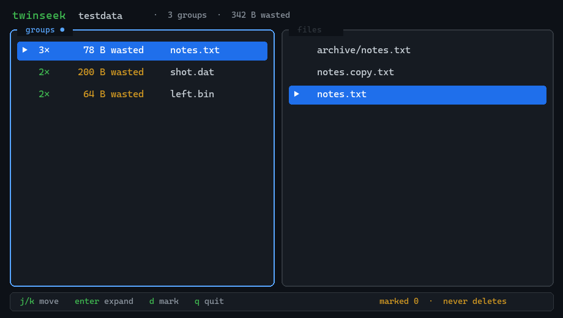

# twinseek

Rust duplicate finder. Size-group, then 4 KiB partial SHA-256, then full SHA-256; unique sizes are never hashed.



## interface

Two panes. Left is groups (count × wasted). Right is paths in the selected group. `d` marks only — twinseek never deletes files.

```
┌ twinseek  testdata  ·  3 groups  ·  342 B wasted ─────────────┐
│ ┌ groups ● ──────────────────┐ ┌ files ─────────────────────┐ │
│ │▶ 3×     78 B wasted notes  │ │  archive/notes.txt         │ │
│ │  2×    200 B wasted shot   │ │  notes.copy.txt            │ │
│ │  2×     64 B wasted left   │ │  notes.txt                 │ │
│ └────────────────────────────┘ └────────────────────────────┘ │
│ j/k move  enter expand  d mark  q quit   marked 0 · never deletes │
└───────────────────────────────────────────────────────────────┘
```

| key | action |
|---|---|
| **j / ↓** | next group, or next path when expanded |
| **k / ↑** | previous |
| **enter / →** | expand — focus the file pane |
| **←** | back to groups |
| **d** | mark (file if expanded, whole group otherwise). toggle |
| **q** | quit; prints marked paths, does not delete |

## session

```
C:\twinseek> twinseek scan testdata
twinseek  testdata  min-bytes=1
scanned 9  hashed 9  unique 2  groups 3  wasted 342 B  skipped 1

#1  2 copies  200 B each  wasted 200 B  sha256:49ba669c7ac7d7cdf5497617f871883ff96d8192272cc4993ffe52052f0df4b1
    photos/shot.bak
    photos/shot.dat

#2  3 copies  39 B each  wasted 78 B  sha256:a5c12b1e148f367836b357d48fced8e2d1d18fea265e33a0c4c28248fa700470
    archive/notes.txt
    notes.copy.txt
    notes.txt

#3  2 copies  64 B each  wasted 64 B  sha256:62b993717837fbf18d748dd6b9e236c3007c4027145d76f739314a319e3ac59f
    twins/left.bin
    twins/right.bin
```

Pipeline: walk and bucket by size; skip hashing any size that appears once; on size collisions, SHA-256 the first 4 KiB in parallel (`rayon`); only prefix collisions go to a full SHA-256 (skipped when the file itself is ≤ 4 KiB). Groups are identical full digests with two or more paths. `d` in the TUI still only marks.

`testdata/` ships three copy-groups, two unique files, and `empty.dat` (0 B, skipped at `--min-bytes 1`). `unique/readme.txt` is a unique size so it is scanned but not hashed. `twinseek scan testdata --json` is the same report.

## build

```
cargo test && cargo build --release && twinseek tui testdata
```
